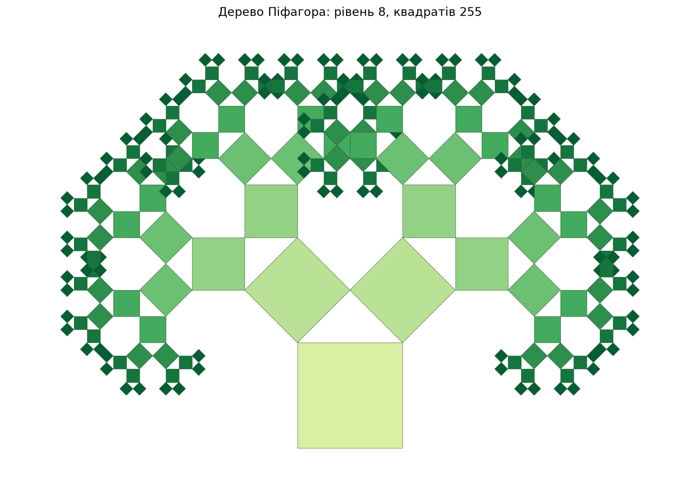
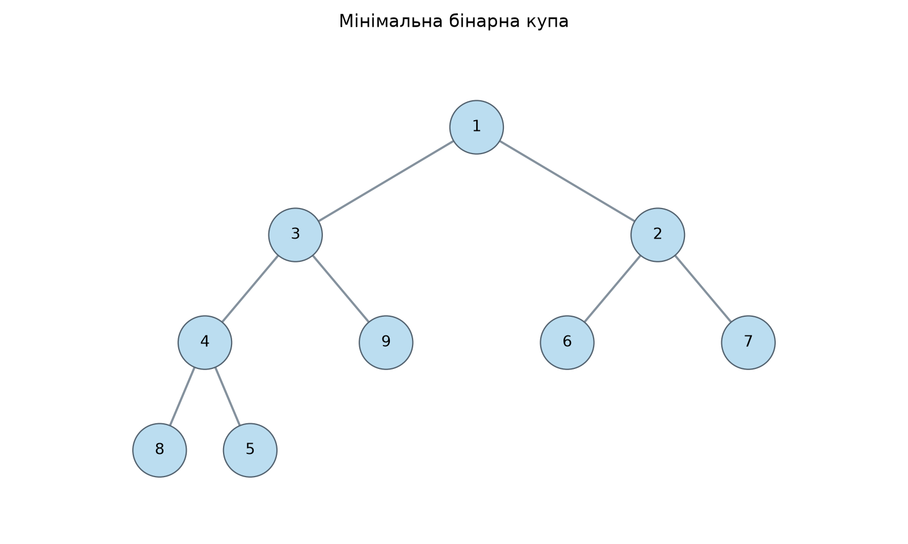
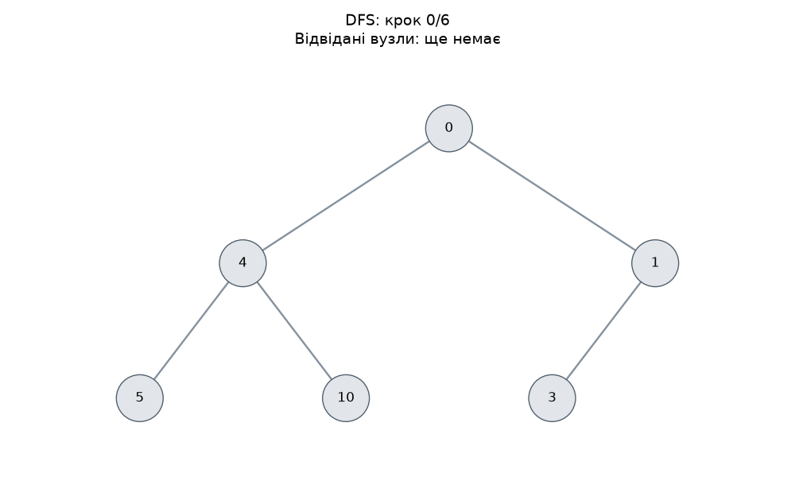
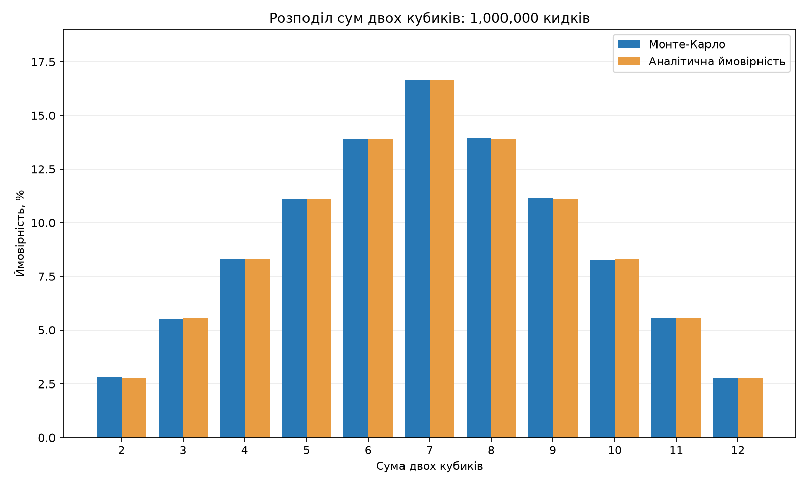

# Фінальний проєкт з алгоритмів

Автор: Суровикін Олександр Сергійович.

Репозиторій: `goit-algo-fp`.

У проєкті виконано сім завдань: робота зі списками, рекурсія, пошук шляхів у графі, візуалізація купи й обходів дерева, вибір їжі та моделювання кидків кубиків.

## Запуск

Потрібні Python 3.12 та бібліотеки з `requirements.txt`. Відкрийте термінал у папці проєкту та виконайте:

```bash
python -m pip install -r requirements.txt
python main.py
```

У Windows замість `python` можна використати `py`, якщо встановлений Python Launcher.

Результати обчислень з'являться в терміналі. Зображення та анімації збережуться в папці `images`. Готові приклади вже додані до проєкту. Повторний запуск оновлює ці файли.

Параметри можна змінити:

```bash
python main.py --depth 9 --budget 120 --rolls 500000 --seed 7
```

За замовчуванням рівень фрактала дорівнює 8, бюджет становить 100, кількість кидків дорівнює 1 000 000, а `seed` дорівнює 42.

Кожне завдання також запускається окремо:

```bash
python task_1.py
python task_2.py --depth 8
python task_3.py
python task_4.py
python task_5.py
python task_6.py --budget 100
python task_7.py --rolls 1000000 --seed 42
```

До команди для `task_2.py` можна додати `--show`, щоб також відкрити вікно з фракталом, якщо середовище підтримує графічні вікна.

## Файли

| Файл | Призначення |
| --- | --- |
| `main.py` | Послідовний запуск усіх завдань |
| `task_1.py` | Реверсування, сортування та злиття однозв'язних списків |
| `task_2.py` | Рекурсивна побудова дерева Піфагора |
| `task_3.py` | Алгоритм Дейкстри з бінарною купою |
| `task_4.py` | Перетворення купи на дерево та візуалізація |
| `task_5.py` | Обходи DFS і BFS та покрокові GIF-анімації |
| `task_6.py` | Жадібний алгоритм і динамічне програмування |
| `task_7.py` | Метод Монте-Карло для двох кубиків |
| `requirements.txt` | Зовнішні бібліотеки |
| `images/` | П'ять PNG-зображень та дві GIF-анімації |
| `.gitignore` | Виключення кешу Python і віртуального середовища |

## Завдання 1. Однозв'язний список

Кожен вузол містить значення `data` та посилання `next` на наступний вузол.

- `reverse_linked_list` змінює напрямок посилань `next` і повертає новий початок списку. Значення між вузлами не переставляються.
- `merge_sort` ділить список навпіл, рекурсивно сортує обидві частини та зливає їх. Вбудоване сортування не використовується.
- `merge_sorted_lists` об'єднує два відсортовані списки, приєднуючи наявні вузли за зростанням значень.

Приклад запуску:

```text
Початковий список: [4, 2, 5, 1, 3]
Після реверсування: [3, 1, 5, 2, 4]
Після сортування: [1, 2, 3, 4, 5]
Злиття [1, 3, 5] та [2, 4, 6]: [1, 2, 3, 4, 5, 6]
```

Функції змінюють посилання в початкових списках, тому потрібно зберігати повернений початок. Для злиття передаються два відсортовані списки без спільних вузлів. Порожній список представлений значенням `None`.

Реверсування працює за `O(n)` і використовує `O(1)` додаткової пам'яті. Сортування злиттям займає `O(n log n)` часу та `O(log n)` пам'яті для рекурсії. Злиття списків довжиною `n` і `m` займає `O(n + m)` часу та `O(1)` додаткової пам'яті.

## Завдання 2. Дерево Піфагора

Фрактал складається з квадратів. Над кожним квадратом будується рівнобедрений прямокутний трикутник, а на його катетах розташовуються два менші квадрати. Для кожної нової гілки функція викликає себе зі зменшеним рівнем рекурсії.

Рівень `1` означає один квадрат. На рівні `d` утворюється `2**d - 1` квадратів. У доданому прикладі рівень дорівнює `8`, тому побудовано `255` квадратів. Площі двох дочірніх квадратів разом дорівнюють площі батьківського квадрата.

Користувач задає рівень через `--depth`. Дозволені значення від 1 до 12, оскільки кількість елементів зростає експоненційно. Час побудови та пам'ять для збереження квадратів становлять `O(2**d)`.



## Завдання 3. Алгоритм Дейкстри

Граф зберігається у словнику суміжності. Черга пріоритетів реалізована через мінімальну бінарну купу `heapq`: на кожному кроці обирається вершина з найменшою відомою відстанню. Після знаходження коротшого шляху нова відстань додається до купи, а застарілі записи пропускаються.

Функція повертає відстані до всіх вершин і словник попередників для відновлення шляхів. Ваги ребер мають бути невід'ємними. У прикладі використано неорієнтований граф, тому кожне ребро записано в обох напрямках.

Результати для початкової вершини `A`:

| Вершина | Відстань | Найкоротший шлях |
| --- | ---: | --- |
| A | 0 | A |
| B | 3 | A → C → B |
| C | 2 | A → C |
| D | 8 | A → C → B → D |
| E | 10 | A → C → B → D → E |
| F | 13 | A → C → B → D → E → F |
| G | ∞ | Недосяжна вершина |

Для недосяжної вершини відстань залишається `inf`, а функція відновлення шляху повертає порожній список. Для простого графа час роботи становить `O((V + E) log V)`, де `V` є кількістю вершин, а `E` є кількістю ребер.

## Завдання 4. Візуалізація бінарної купи

За основу взято клас `Node` і зберігання атрибутів вузлів у NetworkX з умови завдання. Унікальний `id` дозволяє правильно показувати різні вузли з однаковими значеннями.

Функція `visualize_heap` створює мінімальну купу через `heapq.heapify`. Функція `heap_to_tree` будує з її масиву дерево: для елемента з індексом `i` лівий нащадок має індекс `2*i + 1`, а правий має індекс `2*i + 2`.

```text
Початкові значення: [9, 4, 7, 1, 3, 6, 2, 8, 5]
Масив купи:         [1, 3, 2, 4, 9, 6, 7, 8, 5]
```

У мінімальній купі значення батьківського вузла не перевищує значень його дітей. Весь масив при цьому не обов'язково відсортований. Побудова купи та перетворення її на дерево займають `O(n)` часу.



## Завдання 5. Обходи DFS і BFS

Для прикладу використано дерево з умови. DFS реалізовано через стек, а BFS через чергу `collections.deque`. Рекурсія в обходах та побудові графа для їх відображення не використовується.

Порядок відвідування:

- DFS: `0, 4, 5, 10, 1, 3`.
- BFS: `0, 4, 1, 5, 10, 3`.

Кожен відвіданий вузол отримує унікальний колір у форматі `#RRGGBB`. Відтінки поступово світлішають від `#174A7E` до `#BDE4F4`. Невідвідані вузли залишаються сірими, а позначка `#1`, `#2` тощо під значенням показує номер відвідування.

Кожна GIF-анімація містить початковий стан і шість кроків обходу. Окремо збережено PNG із завершеним обходом. Самі алгоритми працюють за `O(n)`; покрокове перемальовування всього дерева потребує додаткового часу.




## Завдання 6. Вибір їжі

Використано всі страви, ціни та калорійність з умови. Прийнято, що кожну страву можна вибрати не більше одного разу. Це задача про рюкзак 0/1. Бюджет є невід'ємним цілим числом.

Функція `greedy_algorithm` сортує страви за спаданням співвідношення калорій до ціни. Потім бере кожну страву, якщо на неї вистачає залишку бюджету.

Функція `dynamic_programming` для кожної страви й кожного доступного бюджету порівнює два варіанти: взяти страву або пропустити її. Таблиця зберігає найбільшу калорійність, а зворотний прохід відновлює назви вибраних страв.

Результат для бюджету **100**:

| Алгоритм | Вибрані страви | Вартість | Калорійність |
| --- | --- | ---: | ---: |
| Жадібний | cola, potato, pepsi, hot-dog | 80 | 870 |
| Динамічне програмування | pizza, pepsi, cola, potato | 100 | 970 |

Жадібний алгоритм витратив менше коштів, але отримав на 100 калорій менше. У цій задачі найкраще співвідношення калорій до ціни на окремому кроці не гарантує найкращого набору. Динамічне програмування враховує обидва варіанти для кожної страви та знаходить максимум у межах бюджету.

Жадібний алгоритм працює за `O(n log n)`. Динамічне програмування використовує `O(nB)` часу та пам'яті, де `n` є кількістю страв, а `B` є бюджетом.

## Завдання 7. Метод Монте-Карло

Під час одного випробування генеруються два незалежні числа від 1 до 6 та обчислюється їхня сума. Для кожної суми від 2 до 12 підраховується кількість появ. Оцінка ймовірності дорівнює кількості появ, поділеній на загальну кількість випробувань.

Для двох чесних кубиків існують 36 рівноймовірних впорядкованих пар. Кількості пар для сум від 2 до 12 становлять `1, 2, 3, 4, 5, 6, 5, 4, 3, 2, 1`. Поділ на 36 дає точні аналітичні ймовірності.

### Результати запуску

Таблицю отримано під час реального запуску програми 7 листопада 2026 року. Виконано **1 000 000 випробувань**, `seed=42`. Фіксований `seed` дозволяє повторити цей результат у тому самому середовищі. Перевірено з Python 3.12.14, Matplotlib 3.11.2, NetworkX 3.7 та Pillow 13.0.0.

| Сума | Кількість появ | Монте-Карло, % | Аналітично, % | Абсолютне відхилення, в.п. |
| ---: | ---: | ---: | ---: | ---: |
| 2 | 28068 | 2.80680 | 2.77778 | 0.02902 |
| 3 | 55336 | 5.53360 | 5.55556 | 0.02196 |
| 4 | 83168 | 8.31680 | 8.33333 | 0.01653 |
| 5 | 111004 | 11.10040 | 11.11111 | 0.01071 |
| 6 | 138835 | 13.88350 | 13.88889 | 0.00539 |
| 7 | 166297 | 16.62970 | 16.66667 | 0.03697 |
| 8 | 139322 | 13.93220 | 13.88889 | 0.04331 |
| 9 | 111468 | 11.14680 | 11.11111 | 0.03569 |
| 10 | 82918 | 8.29180 | 8.33333 | 0.04153 |
| 11 | 55859 | 5.58590 | 5.55556 | 0.03034 |
| 12 | 27725 | 2.77250 | 2.77778 | 0.00528 |

В.п. означає відсоткові пункти. Відхилення обчислено як модуль різниці між отриманою та аналітичною ймовірностями, помножений на 100.



### Висновки щодо Монте-Карло

Найчастіше випала сума 7: її частка становить 16.62970%, тоді як точна ймовірність дорівнює приблизно 16.66667%. Це очікувано, адже суму 7 дають шість різних пар. Суми 2 і 12 трапляються найрідше, бо для кожної існує лише одна пара.

Максимальне абсолютне відхилення в цьому запуску спостерігалося для суми 8 і становило приблизно **0.04331 відсоткового пункта**. Отриманий розподіл близький до аналітичного. Невеликі відмінності між симетричними сумами, наприклад 3 і 11, пояснюються випадковістю скінченної вибірки.

Порівняння узгоджується з правильністю моделювання двох чесних кубиків. Метод Монте-Карло дає наближену оцінку: типова похибка зменшується пропорційно `1 / sqrt(N)`, коли кількість випробувань `N` зростає. Це не означає, що кожен наступний запуск обов'язково буде точнішим. Для цієї простої задачі аналітичний розрахунок дає точну відповідь одразу, а симуляція наочно показує наближення частот до ймовірностей.

Час роботи симуляції становить `O(N)`. Для підрахунку потрібні лише 11 лічильників, тому додаткова пам'ять становить `O(1)`.

## Перевірка

Усі сім завдань перевірено спільним запуском `main.py`. Додатково перевірено порожні списки, повторювані значення, збереження вузлів під час операцій зі списками та недосяжні вершини графа. Результати Дейкстри порівняно з алгоритмом Беллмана-Форда на 50 випадкових графах. Рішення динамічного програмування звірено з повним перебором наборів для бюджетів від 0 до 200. В обох GIF перевірено наявність початкового стану та всіх шести кроків обходу.
